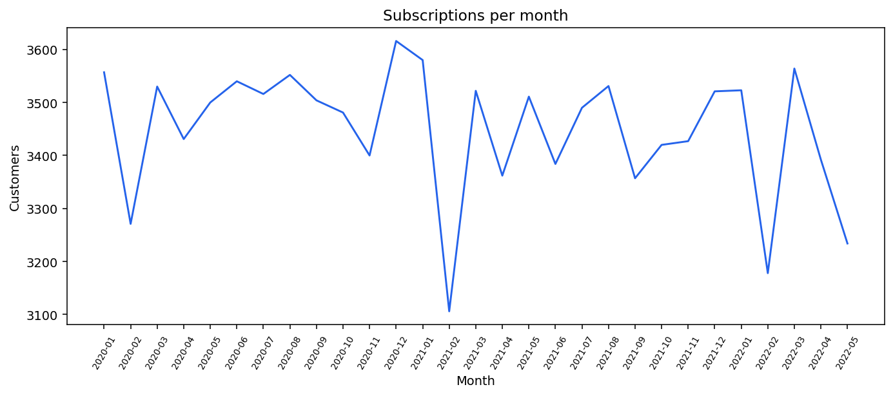
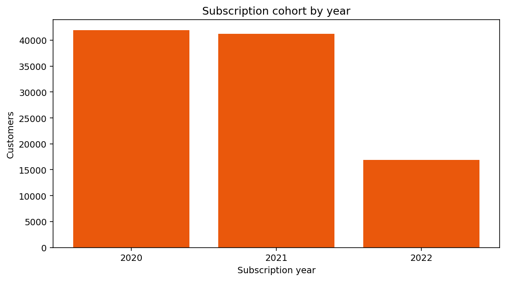
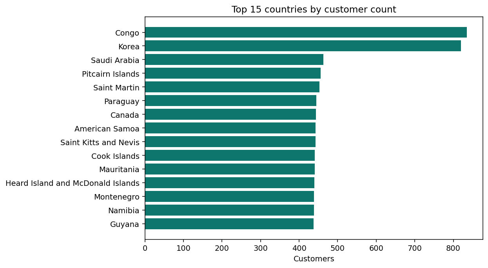
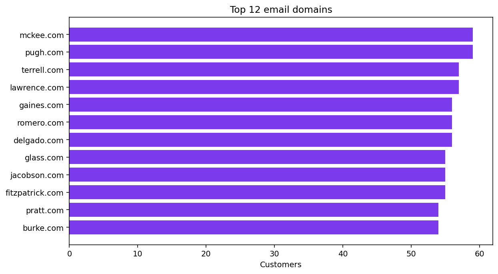
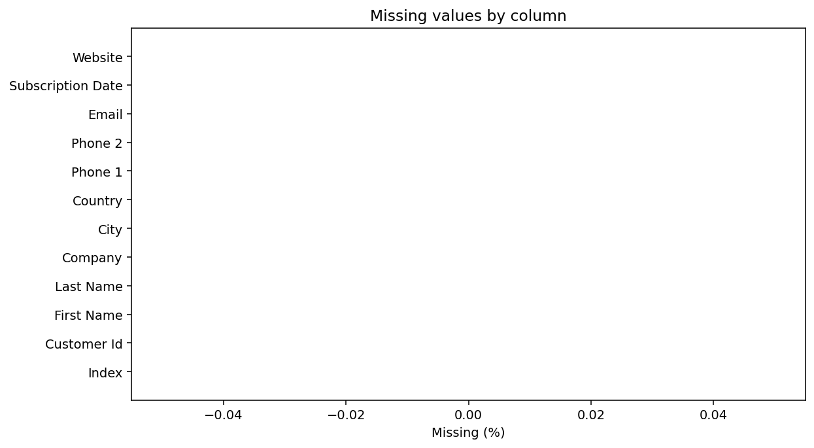

# 100k customer dataset insights

## How to reproduce

```bash
pip install -e ".[dev,analysis]"
python3 -m receipt_ai.csv_analysis.cli \
  --input customers-100000.csv \
  --outdir reports
```

This writes `reports/insights.json` and five charts under `reports/figures/`. Copies of the charts are
committed under `docs/figures/` for reviewers. The analysis finished in about 2.6 seconds on the
development machine and used pandas only for the 100k file.

## Shape and schema

| Property | Value |
| --- | --- |
| Rows | 100,000 |
| Columns | 12 |
| Inferred types | 1 integer, 2 phone, 1 email, 1 date, 1 url, 6 text |
| Unique customer IDs | 100,000 |
| Duplicate customer IDs | 0 |
| Exact duplicate rows | 0 |
| Missing cells | 0 |
| Whitespace defects | 0 |
| Invalid emails | 0 |
| Invalid subscription dates | 0 |
| Future subscription dates | 0 |

The schema inspector identifies `Index` as an integer, `Customer Id`, names, company, city, and
country as text, both phone columns as phone numbers, `Email` as email, `Subscription Date` as a
date, and `Website` as a URL.

## Data quality

The file is unusually clean. Every cell is populated, every email matches a basic address pattern,
every date parses, and the customer identifier is unique. `Index` runs from 1 to 100,000 with a mean
of 50,000.5, which is exactly what a sequential export row number looks like. It is not a business
metric and should not be used as a feature.

Phone coverage is complete. The raw values mix several formats: plain ten digit numbers, dotted
numbers with extensions such as `274.188.8773x41185`, parenthesized area codes, and values prefixed
with `+1`. The profiler treats them as valid after allowing extensions, but a production import
should normalize to E.164 before dialing or deduplicating.

The quality profile is strong evidence that this is synthetic or heavily prepared data. Real
customer exports rarely have zero missing phone numbers, zero invalid emails, and zero duplicate
identifiers across 100,000 rows.

## Subscription timeline

The subscription window is 2020-01-01 through 2022-05-29, a span of 879 days. Annual cohorts are:

| Cohort | Customers | Share |
| --- | --- | --- |
| 2020 | 41,898 | 41.9% |
| 2021 | 41,211 | 41.2% |
| 2022 (partial year) | 16,891 | 16.9% |

The peak month is 2020-12 with 3,616 subscriptions. The 2022 cohort is smaller mostly because the
file stops on 29 May 2022, so it should not be compared directly with full years.





## Recency segments

Using the latest subscription date (2022-05-29) as the reference:

| Segment | Customers | Share |
| --- | --- | --- |
| New, 0 to 90 days | 10,294 | 10.3% |
| Active, 91 to 365 days | 31,046 | 31.0% |
| Lapsing, 366 to 730 days | 41,685 | 41.7% |
| Dormant, over 730 days | 16,975 | 17.0% |

Most of the file is in the lapsing and dormant buckets, which is expected when the export ends in
mid 2022 and the earliest cohort starts in 2020. These segments are descriptive. There is no churn
label, so they should not be presented as predicted churn.

## Geography

There are 243 distinct countries. The distribution is remarkably flat:

- Congo is the largest country with 835 customers, only 0.84% of the file.
- Korea follows with 820 customers, or 0.82%.
- The top ten countries together account for just 5.24% of customers.
- The remaining 233 countries account for 94.8%.



This is not a normal geographic footprint for a real business. It looks like a random draw from a
country list. Segmenting by country is still possible, but the segments will be small and similar in
size. Do not build a strategy that assumes a dominant market.

City cardinality is also very high: 49,154 distinct cities across 100,000 rows. Company cardinality
is 71,994 across 100,000 rows. Company and city are near-unique identifiers here, so they are poor
grouping features unless normalized or enriched externally.

## Email and contactability

All 100,000 emails are valid by the profiler regex. They span 38,322 distinct domains, and no
customer uses a common free provider such as Gmail, Yahoo, Hotmail, or Outlook. The largest domain,
`mckee.com`, has only 59 customers. This supports the synthetic data hypothesis and means email
domain type is not a useful proxy for customer value.

Every row has a valid email and a phone number, so the contactability segmentation puts 100% of the
file in the email and phone bucket. That is useful for an outreach feasibility check, but it gives
no differentiation.



## What this dataset can and cannot support

It supports:

- schema and quality checks for an ingestion pipeline
- subscription cohort and recency reporting
- contact coverage and phone normalization work
- country and city cardinality analysis
- a scale test for the streaming pipeline

It does not support:

- revenue, margin, order frequency, or basket analysis, because there are no transactions
- churn prediction, because there is no churn label or activity event
- lifetime value, because there is no monetary field
- a real geographic strategy, because the distribution is flat and likely synthetic
- company firmographics, because company names are near-unique and not enriched

## Recommendations

1. Keep the quality checks in the ingestion path. The file is clean, but the same checks will catch
   real exports.
2. Normalize phone numbers to E.164 at import and store the raw value for audit.
3. Use subscription recency and cohort as the primary segmentation axes. They are observable and
   interpretable.
4. Treat geography as a coverage dimension, not a value dimension, until a real customer file
   confirms the distribution.
5. Add transaction or event data before attempting value, RFM, or churn modelling.
6. Remove `Index` from feature sets and use `Customer Id` as the stable key.


